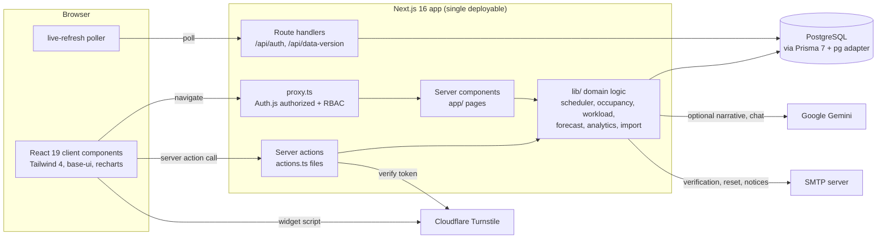

# System Overview

Technical audit of the repository at `e:\Project\scheduling` (branch `refactor/academic-levels-scheduler`). Every finding cites the file it came from. "Not found / unclear" means the repo does not confirm it.

## 1. Project Overview

A full-stack scheduling system for the fictional institution "GRANBY COLLEGES OF SCIENCE & TECHNOLOGY" (`lib/export/report.ts`, `CLAUDE.md`). It covers class and examination timetables, an activity calendar, room booking with automatic conflict resolution, bulk import, analytics, workload optimization, dynamic schedule adjustment, enrollment forecasting, and an optional Gemini-based assistant.

Type: single Next.js App Router application (not a monorepo). There is no separate backend service: server actions and server components query the database directly, and only two route handlers exist (`app/api/auth/[...nextauth]/route.ts`, `app/api/data-version/route.ts`).

Roles (`lib/permissions/roles.ts`, `prisma/schema.prisma` enum `Role`): `ADMINISTRATOR`, `HEAD_OF_DEPARTMENT`, `FACULTY`, `STUDENT` (view-only portal under `/student`).

### Folder structure

| Path | Contents |
|---|---|
| `app/` | App Router pages. `(dashboard)/` holds about 27 staff pages, each with `page.tsx`, a client manager component and an `actions.ts` of server actions. Public auth pages (`login`, `register`, `forgot-password`, `reset-password`, `verify-email`), the `student/` portal, `terms`, `privacy`, `403`. |
| `app/api/` | `auth/[...nextauth]` (Auth.js handlers) and `data-version` (change fingerprint). |
| `actions/` | Cross-page server actions: `auth.ts`, `student-auth.ts`, `archive.ts`, `reorder.ts`. |
| `components/` | `ui/` (30 primitives), `ux/`, `layout/`, `scheduler/`, `dashboard/`, `auth/`, `workload/`, `charts/`, `assistant/`, `rooms/`, `student/`, `academics/`, `errors/`, `legal/`. |
| `lib/` | Domain logic: `scheduler/` (conflict detection, constraints, suggestions), `occupancy/` (shared pure engine for dated sessions, bookings, adjustments), `workload/`, `forecast/`, `analytics/`, `import/`, `export/`, `ai/`, `auth/`, `permissions/`, `email/`, `archive/`, `activities/`, `requests/`, `rooms/`, `db/prisma.ts`. |
| `prisma/` | `schema.prisma`, 9 migrations, `seed.ts` and sample-data generators. |
| `tests/` | 12 Vitest files (pure-logic tests). |
| `proxy.ts`, `auth.ts`, `auth.config.ts` | Edge proxy (route guard) and Auth.js configuration. |
| `docs/` | `activity-log.md`, `QA-CHECKLIST.md`. |
| `graphify-out/`, `.agents/`, `.codex/`, `AGENTS.md`, `skills-lock.json` | AI tooling artifacts, not application code. |

## 2. Tech Stack Summary

| Layer | Technology | Version | Declared in |
|---|---|---|---|
| Framework | Next.js (App Router, `proxy.ts`, `authInterrupts`) | 16.3.5 | `package.json` |
| UI runtime | React / React DOM | 19.2.8 | `package.json` |
| Language | TypeScript (`strict: true`) | ^5 (5.9.3 installed) | `package.json`, `tsconfig.json` |
| Styling | Tailwind CSS + `tw-animate-css` | ^4 (4.3.3 installed) | `package.json`, `postcss.config.mjs` |
| Components | `@base-ui/react`, shadcn config, `cmdk`, `sonner`, `@phosphor-icons/react` | 1.8.0 / ^4.21.0 / ^1.1.1 / ^2.0.8 / ^2.1.10 | `package.json`, `components.json` |
| Forms | `react-hook-form`, `@hookform/resolvers`, `zod` | ^7.88.0 / ^5.9.1 / ^4.6.5 | `package.json` |
| Charts | `recharts` | ^3.8.0 | `package.json` |
| Drag and drop | `@dnd-kit/*` | ^6.3.1 / ^10.0.0 | `package.json` |
| Auth | `next-auth` (Auth.js v5, Credentials, JWT) | ^5.0.0-beta.32 | `package.json`, `auth.ts` |
| Password hashing | `bcryptjs` | ^3.0.3 | `package.json` |
| ORM | Prisma Client with `@prisma/adapter-pg`, `pg` | 7.10.0 / ^8.23.0 | `package.json`, `lib/db/prisma.ts` |
| Database | PostgreSQL | Not found / unclear (provider-agnostic; Supabase referenced) | `prisma/schema.prisma`, `.env.example` |
| Email | `nodemailer` (SMTP) | ^8.0.11 | `lib/email/mailer.ts` |
| AI | `@google/genai` (Gemini) | ^2.23.0 | `lib/ai/geminiClient.ts` |
| CAPTCHA | Cloudflare Turnstile (plain `fetch`) | n/a | `lib/auth/captcha.ts` |
| 2FA | In-house TOTP, `qrcode` for the setup QR | ^1.5.4 | `lib/auth/totp.ts` |
| Tests | Vitest | ^4.1.11 | `package.json`, `vitest.config.mts` |
| Lint | ESLint 9 with `eslint-config-next` | ^9 / 16.3.5 | `eslint.config.mjs` |
| Dates | `date-fns`, `react-day-picker` | ^4.4.0 / ^10.0.1 | `package.json` |
| Node runtime | Not found / unclear (no `engines`, `.nvmrc` or Dockerfile; `@types/node` is ^20) | | `package.json` |

## 3. Frontend

- **Framework:** Next.js 16 App Router with React 19 server components; client components for interactive managers (`app/(dashboard)/*/*-manager.tsx`, `components/scheduler/scheduler-workspace.tsx`). Language: TypeScript.
- **Build tool:** `next build` (Next's bundler; no custom bundler config in `next.config.ts`). PostCSS runs `@tailwindcss/postcss` (`postcss.config.mjs`).
- **Routing:** file-based. Permanent redirects for retired routes in `next.config.ts` (`/schedules`, `/ai-scheduler`, `/conflicts` to `/scheduler`; `/semesters` to `/academic-years`). Breadcrumbs from `lib/navigation/breadcrumbs.ts`, sidebar from `components/layout/nav-config.ts`.
- **Academic Record:** programs and the academic calendar share `/programs`, with level-specific course or strand lists. `/academic-years` redirects to `/programs#academic-calendar`; existing year-detail routes remain available. Calendar loading and mutations require Super Administrator or Registrar access; Heads retain their scoped program and department-profile views.
- **Submission Monitoring:** Super Administrator and Registrar review subject assignment proposals at `/admin/review-center?queue=subject-assignments`, alongside the timetable and booking queues. Their old `/assignment-approvals` links redirect there; Heads of Department retain the original scoped approval page. Assignment review permissions, warnings, and decisions are shared between both entry points.
- **State management:** no global store. Server data comes through server components; local state with React hooks and URL-synced filters (`components/scheduler/use-scheduler-filters.ts`). `@tanstack/react-query` is wrapped in `app/providers.tsx` but no `useQuery` or `useMutation` call was found, so it appears unused. Theme is cookie-based (`lib/theme/`).
- **Live updates:** `components/ux/live-refresh.tsx` polls `/api/data-version` on an interval and on tab focus, then refreshes the route when the fingerprint changes.
- **UI:** in-repo components in `components/ui/` built on `@base-ui/react`, `class-variance-authority`, `tailwind-merge`, `clsx`; toasts via `sonner`; command palette via `cmdk`; charts via `recharts` (`components/ui/chart.tsx`, `components/charts/`).
- **Styling:** Tailwind CSS 4 with `app/globals.css`; light and dark themes (`lib/theme/theme-provider.tsx`).
- **Forms and validation:** `react-hook-form` with `@hookform/resolvers` and `zod` (6 files each use the first two; `lib/validation/auth.ts` holds auth schemas).
- **Backend calls:** mostly Next.js server actions invoked directly from client components (no axios, no fetch wrapper). The one `fetch` from the browser is the `/api/data-version` poll; the Turnstile widget loads `https://challenges.cloudflare.com/turnstile/v0/api.js` (`components/auth/captcha.tsx`).
- **Export:** CSV via `Blob` download (`lib/export/csv.ts`); PDF through a print-styled HTML document opened for the browser's print dialog (`lib/export/report.ts`, `printReport`). There is no PDF library.

## 4. Backend

- **Language and framework:** TypeScript on Next.js 16 server runtime (server actions, server components, two route handlers). Node version: Not found / unclear.
- **Architecture:** layered inside one app. Pages and `actions.ts` files (transport) call `lib/<domain>/` modules (business logic, several pure and unit-tested) which call Prisma (`lib/db/prisma.ts`). The shared scheduling math lives in `lib/occupancy/engine.ts` and `lib/scheduler/conflictDetector.ts`.
- **Authentication:** Auth.js v5 Credentials provider with JWT sessions (`auth.ts`, `auth.config.ts`). Flow: Turnstile check (optional), per-IP failure limit, user lookup, constant-time dummy hash for unknown emails, per-account lockout, portal check (student vs staff), optional TOTP, email-verified and status checks, bcrypt rehash to the configured cost. The `jwt` callback re-reads the user on every request so role changes, deactivation, archiving and `sessionVersion` bumps ("sign out everywhere") apply immediately. Sign-in and sign-out write `AuditLog` rows.
- **Authorization:** three layers.
  1. `proxy.ts` runs Auth.js `authorized()` and `canAccessPath()` (`lib/permissions/routes.ts`), answering 403 for forbidden prefixes.
  2. Pages and actions call `requireUser`, `requireRole` (`lib/auth/session.ts`) or `requireScope` (`lib/permissions/scope.ts`).
  3. `Scope.manageDepartmentId` limits a Head of Department to their own department; `canManageDepartment` and `lib/permissions/department.ts` apply it to queries.
- **Middleware:** `proxy.ts` (the Next.js 16 name for middleware), matcher excludes static assets.
- **Background jobs and queues:** Not found / unclear. No cron, queue or worker was found. Everything runs inside requests.
- **Logging and errors:** `console.warn` for tolerated database outages in `auth.ts`; Prisma logs `error`/`warn` in development and `error` in production (`lib/db/prisma.ts`). Business events go to the `AuditLog` table and in-app `Notification` rows (`lib/notify.ts`). Custom `LoginError` codes in `lib/auth/errors.ts`; `app/forbidden.tsx` and `app/unauthorized.tsx` render 403 and 401. No external logging or error tracking service found.
- **AI features:** in-house algorithms for workload, forecasting and adjustments; Gemini only adds narrative text and powers the chat assistant when `GEMINI_API_KEY` is set (`lib/ai/`, `docs/activity-log.md`).

## 5. Database and Storage

- **Database:** PostgreSQL via Prisma 7 `provider = "postgresql"` (`prisma/schema.prisma`). Runtime connection uses `DATABASE_URL` through `@prisma/adapter-pg` with a pool of 5 (`lib/db/prisma.ts`); migrations and seeding use `DIRECT_URL` (`prisma.config.ts`). `.env.example` names Neon and Supabase as options and `docs/activity-log.md` mentions a remote Supabase database.
- **ORM:** Prisma Client (`prisma-client-js`), generated on `postinstall`.
- **Migrations:** 9 folders in `prisma/migrations/` (init, daily stat, auth module, academic levels, full feature set, continuous workload, constraints/rooms/students, archive and activity approvals, building details). Seed: `npx tsx --conditions=react-server prisma/seed.ts` (`prisma.config.ts`), with `sample-timetable.ts`, `sample-history.ts`, `sample-archive-activities.ts`. The activity log notes `prisma migrate reset` does not run the seed in Prisma 7.
- **Schema size:** 1106 lines, about 36 models, 33 `@@index`/`@@unique` declarations.
- **Main entities and relationships** (`prisma/schema.prisma`):

| Area | Models | Key relations |
|---|---|---|
| Identity | `User`, `AuthToken`, `LoginAttempt`, `Student`, `AuditLog`, `Notification` | `User.facultyId` links to `Faculty`; `Student` links to `User` and `Section` |
| Organization | `Department`, `Program`, `Faculty`, `FacultyAvailability` | `Department` owns programs, faculty, rooms, sections, subjects |
| Academic calendar | `AcademicYear`, `Semester` | `Semester` belongs to a year and a program |
| Curriculum | `Subject`, `Section` | both reference `Program`, `Department`, and (sections) `Semester` |
| Facilities | `Building`, `Floor`, `Room`, `RoomAvailability` | `Building` to `Floor` to `Room`; rooms may have an owning department |
| Timetable | `Schedule`, `TimeSlot`, `SchedulingConstraint` | `Schedule` joins semester, subject, section, faculty, room with day and minute range |
| Examinations | `Examination`, `ExamBatch` | exam joins semester, subject, section, room, proctor |
| Calendar | `Activity`, `ActivityProposal`, `ActivityProposalRow` | proposals are reviewed and expand into activities |
| Booking and adjustment | `RoomBooking`, `Unavailability`, `AdjustmentBatch`, `ScheduleAdjustment` | adjustments override one dated meeting; a batch can be undone as a whole |
| Workload | `WorkloadProposal`, `WorkloadFix` | fix moves a class between two `Faculty` |
| Forecasting | `EnrollmentRecord` | per program history |
| Requests | `ScheduleRequest` | links schedule, requester, reviewer, target department |
| AI and settings | `AIConversation`, `AIMessage`, `SystemSetting`, `DailyStat` | |

- **Soft delete:** users, faculty, subjects, rooms and sections carry `archivedAt`/`archivedById` (`actions/archive.ts`, `lib/archive/`).
- **Caching:** none (no Redis or similar). `/api/data-version` is `force-dynamic` and `no-store`.
- **File storage:** no object storage. Building photos are stored in the database as `Bytes` columns (`Building.photo`, `photoType`, `photoUpdatedAt`), uploaded through a server action with a 2 MB body limit (`next.config.ts`, `app/(dashboard)/rooms/[buildingId]/photo`).

## 6. APIs

- **Style:** Next.js server actions (RPC over POST, not a public REST contract), plus two REST-style route handlers. No GraphQL, gRPC or WebSocket found.
- **Endpoints, request formats and validation:** see [API_REFERENCE.md](API_REFERENCE.md).
- **API documentation tools:** none (no OpenAPI, Swagger or Postman files found).

## 7. Third-Party Services and Integrations

| Service | Purpose | Evidence |
|---|---|---|
| Google Gemini (`@google/genai`) | Scheduling Assistant chat, narrative text on workload and forecast pages; optional, degrades without key | `lib/ai/geminiClient.ts`, `lib/ai/narrative.ts`, `lib/ai/scheduleAssistant.ts` |
| Cloudflare Turnstile | CAPTCHA on login and student registration; disabled when keys are absent | `lib/auth/captcha.ts`, `components/auth/captcha.tsx`, `actions/student-auth.ts` |
| SMTP server via nodemailer | Verification, password reset and notification emails; no transport when `SMTP_HOST` is unset | `lib/email/mailer.ts`, `lib/email/templates.ts` |
| PostgreSQL host (Neon/Supabase) | Database | `.env.example`, `docs/activity-log.md` |
| Vercel | Hosting hint: `.vercel/project.json` exists (ignored by git) and `VERCEL_OIDC_TOKEN` appears in `.env.local` | `.vercel/`, `.gitignore` |

Not found: payment, analytics, OAuth providers, SMS. `openai` is a dependency but is never imported.

## 8. Environment and Configuration

Variable names only. Values were not read into this document.

| Variable | Used for | Where |
|---|---|---|
| `DATABASE_URL` | Runtime Postgres connection (pooled) | `lib/db/prisma.ts` |
| `DIRECT_URL` | Direct connection for Prisma migrate and seed | `prisma.config.ts` |
| `AUTH_SECRET` | Auth.js signing; also derives the AES key that encrypts TOTP secrets | `lib/auth/crypto.ts` |
| `NEXTAUTH_URL` | Auth.js base URL | `lib/email/mailer.ts` (fallback) |
| `NEXT_PUBLIC_APP_URL` | Absolute links in emails | `lib/email/mailer.ts` |
| `GEMINI_API_KEY` | Enables Gemini features | `lib/ai/geminiClient.ts` |
| `GEMINI_SCHEDULING_MODEL` | Model name, default in code | `lib/ai/geminiClient.ts` |
| `GEMINI_ASSISTANT_MODEL` | Assistant model, falls back to scheduling model | `lib/ai/scheduleAssistant.ts` |
| `SMTP_HOST`, `SMTP_PORT`, `SMTP_USER`, `SMTP_PASSWORD`, `EMAIL_FROM` | Outgoing email | `lib/email/mailer.ts` |
| `NEXT_PUBLIC_TURNSTILE_SITE_KEY`, `TURNSTILE_SECRET_KEY` | CAPTCHA | `lib/auth/captcha.ts` |
| `VERCEL_OIDC_TOKEN` | Present in `.env.local`; no reference in source (Vercel CLI artifact) | `.env.local` |
| `NODE_ENV` | Prisma log level, client caching | `lib/db/prisma.ts` |

Config files: `next.config.ts`, `tsconfig.json`, `eslint.config.mjs`, `postcss.config.mjs`, `vitest.config.mts`, `prisma.config.ts`, `components.json`, `.env.example`. Application settings live in the `SystemSetting` table (`lib/settings.ts`, e.g. teaching-load limits, `auth.requireAdminApproval`). Tunables for auth are in `lib/auth/config.ts` (bcrypt cost 12, 5 failed attempts then 15-minute lock, 20 failures per IP per 15 minutes, 30-day remembered and 8-hour normal sessions, 24-hour verification and 30-minute reset token lifetimes).

## 9. DevOps and Deployment

- **Docker:** Not found. **CI/CD:** Not found (no `.github/`, no other pipeline file).
- **Hosting hint:** Vercel (`.vercel/project.json`, `.gitignore`); no `vercel.json`.
- **Scripts** (`package.json`): `dev`, `build`, `start`, `lint`, `test`, `test:watch`; `postinstall` runs `prisma generate`.
- **Environments:** dev, staging and prod separation: Not found / unclear. Only `.env`, `.env.local`, `.env.example` exist.
- **Migration on deploy:** no script runs `prisma migrate deploy`; Not found / unclear how production migrations are applied.

## 10. Testing and Code Quality

- **Framework:** Vitest 4, node environment, `tests/**/*.test.ts` (`vitest.config.mts`).
- **Tests (12 files):** activity proposals, analytics, calendar, conflict detector, constraints, forecast, import, misc, occupancy, report affected classes, student access, timetable, workload. All exercise pure `lib/` logic.
- **Not covered:** server actions, database access, components, end-to-end flows. `docs/QA-CHECKLIST.md` suggests manual QA.
- **Lint:** ESLint 9 flat config with `core-web-vitals` and TypeScript presets. **Formatter:** none found (no Prettier config). **Type checking:** `strict: true`, no separate `tsc` script (Next build type-checks).

## 11. Security Observations

Positives:
- Passwords hashed with bcrypt cost 12 with transparent rehash; dummy-hash comparison for unknown emails limits user enumeration (`auth.ts`).
- Account lockout, per-IP failure rate limit stored in `LoginAttempt`, optional Turnstile, optional TOTP with AES-256-GCM encrypted seeds, tokens stored as SHA-256 hashes (`lib/auth/crypto.ts`).
- Server-side RBAC at three layers; students and staff are separated at both login and route level; sessions revalidated against the database on each request.
- No raw SQL (`$queryRaw`/`$executeRaw` not found). The only `dangerouslySetInnerHTML` is in `components/ui/chart.tsx` (a theme style block).
- `.env*` files are git-ignored (`.gitignore`; only `.env.example` is tracked in the working tree per `git check-ignore`).

Risks and open points:
- **Rate limiting is login-only.** Registration, forgot-password and server actions have no general limiter (only a per-account resend cooldown, `AUTH.emailResendCooldownSeconds`). Not found / unclear for the rest.
- **Client IP** is taken from `x-forwarded-for` or `x-real-ip` (`lib/auth/rate-limit.ts`); safe only behind a proxy that overwrites these headers.
- **CAPTCHA and email degrade open** when keys or SMTP are missing; confirm production sets them.
- **TOTP key derives from `AUTH_SECRET`**; rotating the secret invalidates stored 2FA seeds and sessions.
- **No security headers, CSP or CORS config** in `next.config.ts` or the proxy; CORS is not applicable to server actions but nothing is set for the two route handlers.
- **Session lifetime:** the "remembered" session is 30 days.
- **Dependencies:** `next-auth` is a beta (`5.0.0-beta.32`).
- **Photos in the database** (up to 1.5 MB after client-side resizing, 2 MB limit) increase database size; the server checks the browser-declared MIME type against an allowlist and a size cap (`app/(dashboard)/rooms/actions.ts`) but not the file's magic bytes.
- **Secrets on disk:** `.env` and `.env.local` contain live-looking variable sets (names confirmed, values not read); keep them out of version control and AI context.

## 12. How to Run Locally

Prerequisites: Node.js (version not pinned; a current LTS compatible with Next 16 is needed), npm (`package-lock.json`), a PostgreSQL database.

```bash
npm install                      # also runs prisma generate
cp .env.example .env             # then fill in DATABASE_URL, DIRECT_URL, AUTH_SECRET, NEXTAUTH_URL, NEXT_PUBLIC_APP_URL
npx prisma migrate deploy        # or: npx prisma migrate dev
npx prisma db seed               # sample data (seed dates are relative to the run day)
npm run dev                      # http://localhost:3000
npm run build && npm start       # production build
npm run lint
npm test
```

Optional: `GEMINI_API_KEY` for the assistant, `SMTP_*` for email, Turnstile keys for CAPTCHA. Seeded login credentials are defined in `prisma/seed.ts` and are not reproduced here. The root `README.md` is the unmodified create-next-app text and does not document any of this.

## 13. Architecture Diagram



## 14. Gaps and Recommendations

- **Docs:** `README.md` is boilerplate; no setup, seed-credential, deployment or architecture notes. Add a real README and an `.nvmrc` or `engines` entry.
- **Unused dependencies:** `openai`, `@auth/prisma-adapter`, `shadcn` (CLI listed as a runtime dependency) and `@tanstack/react-query` (provider only). Inconsistency: 29 files import `cn` from the third-party `cn` npm package while 46 import it from `@/lib/utils`; standardize on the local helper. Removing them shrinks the install and the attack surface.
- **No CI or Docker:** add a pipeline that runs `lint`, `tsc --noEmit`, `test` and `prisma migrate deploy` checks.
- **Test coverage:** logic is tested, but server actions and authorization paths are not; add integration tests for `requireScope` flows and double-booking prevention.
- **Beta dependency:** `next-auth@5.0.0-beta.32` pinned by caret; consider an exact pin.
- **Rate limiting and security headers** as noted in section 11.
- **Live refresh design:** `/api/data-version` runs 13 aggregate queries per poll per open tab; the activity log already records slow dashboards against the remote database. Consider a lighter version counter.
- **Naming inconsistency:** `CLAUDE.md` asks for kebab-case Markdown names; this audit's files use the names that were requested (`SYSTEM_OVERVIEW.md`, `API_REFERENCE.md`), and `docs/QA-CHECKLIST.md` also differs.
- **Uncommitted work:** the working tree has many modified files on a feature branch; this document reflects the working tree, not a tagged commit.
